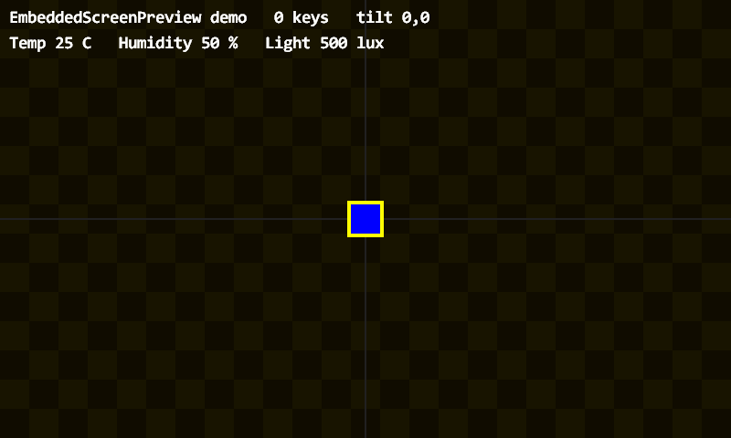
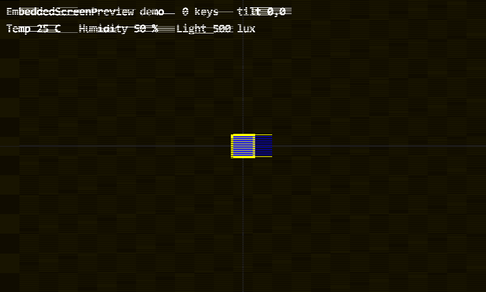

# EmbeddedScreenPreview

**English** | [中文](README_CN.md)

A Windows **workbench for previewing embedded projects that draw into an RGB565
framebuffer**.

No flashing, no board, no CPU emulator. If your project writes pixels into a
framebuffer, this tool shows that framebuffer live in a window — so the loop
becomes *edit → build (2 s) → see it* instead of
*edit → build → flash → photograph the screen → squint*.

```
open fbview.exe  →  pick a project folder  →  it runs
```

---

## Demo

The screenshots below are produced by the tool itself (`-export`), text included.
The second one shows the same frame with the simulated memory bandwidth capped at
55 MB/s:

| normal | bandwidth limited to 55 MB/s |
|---|---|
|  |  |

---

## What you see

The window is a workbench, not just a raw framebuffer:

| Panel | Contents |
|---|---|
| **LCD preview** | the project's framebuffer, scaled to fit; mouse clicks are mapped back to native LCD coordinates |
| **RGB indicators** | the project's LED state, if the adapter exports `Pv_LedColor` |
| **Built-in inputs** | simulated tilt |
| **Added inputs** | temperature / humidity / light / pressure / distance / voltage / potentiometer, if the adapter exports `Pv_SetSensor` |
| **Log** | the project's `stdout` / `stderr`, captured in-window |

The UI is bilingual — Chinese or English, following the system locale.

---

## How it works

The tool knows nothing about any specific project. A project builds a small
**adapter DLL** exporting five required `Pv_*` functions, plus optional ones. The
host passes its capabilities through an `FvHost` struct, so adapters never link
back into the executable — no import library, no exported exe symbols.

```
   keyboard / clock / sliders
          │
          ▼
   ┌──────────────┐   FvHost { fb, w, h, draw_text, tilt, fps }
   │  fbview.exe  │ ─────────────────────────────────────────────┐
   └──────┬───────┘                                               │
          │ Pv_Attach / Pv_Update / Pv_Render / Pv_Key / Pv_Title │
          │ optional: Pv_Touch / Pv_SetSensor / Pv_LedColor / Pv_SerialRx
          ▼                                                       ▼
   ┌──────────────┐  writes RGB565 pixels   ┌──────────────────────┐
   │ adapter DLL  │ ──────────────────────▶ │ framebuffer (w × h)  │
   └──────────────┘                         └──────────────────────┘
```

Your `game.c`, `app.c`, `render.c` — or whatever draws — stays untouched. You add
a thin adapter file and a small `preview.ini`.

---

## Quick start

```powershell
.\build.ps1
.\fbview.exe
```

`fbview.exe` opens a folder picker; choose a folder containing an adapter DLL or a
`preview.ini`.

```powershell
.\fbview.exe -dir <project folder>
.\fbview.exe -dir <project folder> -export frame.bmp   # offscreen, no window
.\fbview.exe -dir <folder A> -dir <folder B>           # switch on the fly
.\fbview.exe -bandwidth 55                             # simulate 55 MB/s SDRAM
.\fbview.exe -list                                     # check loadability only
```

> If PowerShell refuses to run the scripts ("not digitally signed"):
> `powershell -NoProfile -ExecutionPolicy Bypass -File .\build.ps1`.

### Hotkeys

| Key | Action |
|---|---|
| `W` `A` `S` `D` | simulated tilt (ramps while held, decays on release) |
| `1` / `2` | KEY1 / KEY2 to the adapter |
| `F1` | debug overlay: fps, frame time, bandwidth, tilt |
| `F12` | screenshot to `screenshots\shot_NNNN.bmp` |
| `Space` | pause / resume (still renders, logic frozen) |
| `F11` | fullscreen |
| `R` | **reload the adapter DLL** — rebuild, press R, no restart |
| `Esc` | quit |

---

## Adapter discovery

| Order | Condition |
|---|---|
| 1 | `preview.ini` has `dll=` and the file exists → load it |
| 2 | any `*adapter*.dll` in the folder |
| 3 | `preview.ini` has `sources=` → compile with gcc into `_fbview\adapter.dll`, then load |
| 4 | none → an error dialog explains what is missing |

Compilation happens once and is cached in `_fbview\`; delete that folder to force
a rebuild.

### `preview.ini`

```ini
width=800
height=480
fps=30
title=My project

; memory model
bandwidth_mb_s=0      ; 0 = unlimited
scan_hz=0             ; 0 = derive from fps
write_passes=1

dll=my_adapter.dll

; used only when the DLL is absent (comma separated, relative to this folder)
sources=src\adapter.c,src\game.c,src\render.c
includes=src
defines=PC_PREVIEW
```

---

## Writing an adapter

Full example: [`demo_adapter.c`](demo_adapter.c).

```c
#define FBVIEW_BUILD_DLL          /* must come before the include */
#include "fbview.h"

static const FvHost *s_host;

/* required */
int  Pv_Attach(const FvHost *host)            { s_host = host; return 0; }
void Pv_Update(float tx, float ty, float dt)  { /* your logic */ }
void Pv_Render(void)                          { /* write RGB565 into s_host->fb */ }
void Pv_Key(int key)                          { }
const char *Pv_Title(void)                    { return "my project"; }

/* optional — implement only what your project actually has */
void     Pv_Touch(int x, int y, int pressed)    { }  /* 1 down/move, 0 release, -1 cancel */
void     Pv_SetSensor(int sensor, float value)  { }  /* FV_SENSOR_* */
uint32_t Pv_LedColor(unsigned index)            { return 0; }
void     Pv_SerialRx(const char *bytes, size_t len) { }
```

Build it:

```powershell
gcc -std=c11 -O2 -shared -DFBVIEW_BUILD_DLL -I<this folder> -I<your headers> `
    -o <project folder>\my_adapter.dll adapter.c your_other_sources.c
```

### `FvHost`

| Field | Meaning |
|---|---|
| `fb` | framebuffer, `uint16_t*`, RGB565, length `w*h` |
| `w`, `h` | size from `preview.ini` |
| `draw_text(s, x, y, c565)` | draw a string with a system font, blended into the surface |
| `tilt_x`, `tilt_y` | current simulated tilt |
| `fps` | target frame rate |

### Sensor ids

`FV_SENSOR_TEMPERATURE`, `HUMIDITY`, `LIGHT`, `PRESSURE`, `DISTANCE`,
`VOLTAGE`, `POTENTIOMETER` (12-bit, 0–4095).

---

## SDRAM bandwidth model

`fv_sim.c` implements a frame-level contention model — deliberately a *teaching
model*, not a cycle-accurate FMC simulation:

```
read  = pixels × 2 bytes × scan_hz            (the display controller always reads)
write = pixels × 2 bytes × fps × write_passes (the CPU writes)
```

When demand exceeds the budget, grants accumulate per 64-byte read burst; a burst
that is not granted repeats the last delivered pixel — which is exactly the
horizontal streaking seen when the pixel clock is set too high for the memory bus.

At 800×480 RGB565 and 30 fps: `scan 46.08 + write 23.04 = 69.12 MB/s`.

---

## Build and test

```powershell
.\build.ps1        # fbview.exe + demo_adapter.dll
.\test.ps1         # loader / bandwidth model / host plumbing / terminal / export
```

Requires gcc (MSYS2 mingw64) and Windows system libraries only
(`gdi32`, `user32`, `shell32`, `ole32`, `comctl32`). No third-party dependencies.

The suite covers adapter reload and failure cleanup, viewport math, bandwidth
thresholds, starvation and recovery, project switching and rollback, terminal
capture and descriptor restoration, and the offscreen export (BMP geometry, that
bandwidth limiting actually changes the frame, and that text reaches the export).

---

## Known limitations

| Limitation | Reason |
|---|---|
| No LTDC timing model | this is not a hardware simulator |
| Bandwidth is frame-level, not per-scanline | see the roadmap |
| Writes always win arbitration | real FMC contends in both directions |
| `write_passes` is a manual estimate | adapters cannot report actual write volume yet |
| Sensors are values, not device models | no I2C register emulation |

Hardware-level verification (interrupts, DMA, real timing) needs a different class
of tool, such as Renode with its `Video.STM32LTDC` model.
See [ROADMAP.md](ROADMAP.md).

---

## License

MIT — see [LICENSE](LICENSE).
