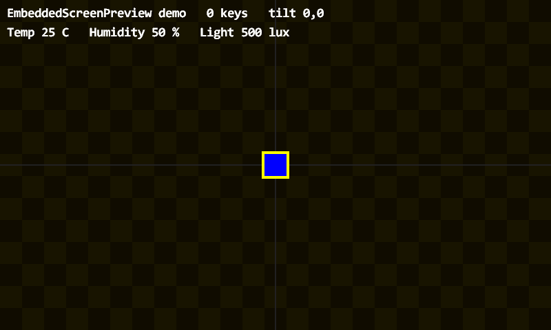
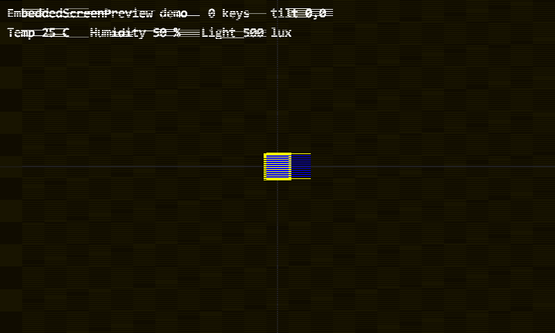

# EmbeddedScreenPreview

[English](README.md) | **中文**

一个 Windows 上的**嵌入式项目预览工作台**，专门用来显示"往 RGB565 帧缓冲里画像素"的项目。

不烧录、不接板子、不模拟 CPU。只要你的项目最终是往一块显存里写像素，
这个工具就能在窗口里实时显示那块显存 —— 于是开发循环从
*改 → 编译 → 烧录 → 拍照 → 眯眼看* 变成 *改 → 编译（2 秒）→ 看见*。

```
打开 fbview.exe  →  选一个项目文件夹  →  跑起来
```

---

## 演示

下面两张图都是这个工具自己导出的（`-export`，**包含文字**）。
第二张是把模拟的内存带宽压到 55 MB/s 之后的同一帧：

| 正常 | 带宽压到 55 MB/s |
|---|---|
|  |  |

---

## 窗口里有什么

这不是一个裸的帧缓冲窗口，而是一个工作台：

| 面板 | 内容 |
|---|---|
| **LCD 预览** | 项目的帧缓冲，等比缩放；鼠标点击会反算回原生 LCD 坐标 |
| **RGB 指示灯** | 项目的 LED 状态，需要适配器导出 `Pv_LedColor` |
| **基础输入** | 模拟倾斜 |
| **扩展输入** | 温度 / 湿度 / 光照 / 气压 / 距离 / 电压 / 电位器，需要适配器导出 `Pv_SetSensor` |
| **日志** | 项目的 `stdout` / `stderr`，捕获到窗口内 |

界面是**中英双语**，跟随系统语言。

---

## 它是怎么做的

这个工具**不认识任何具体项目**。项目自己编一个小的**适配器 DLL**，
导出 5 个必需的 `Pv_*` 函数（以及若干可选的）。宿主把自身能力通过
`FvHost` 结构体交给适配器，所以适配器**不需要反向链接 exe** ——
不需要 import library，exe 也不用导出任何符号。

```
   键盘 / 时钟 / 滑条
          │
          ▼
   ┌──────────────┐   FvHost { fb, w, h, draw_text, tilt, fps }
   │  fbview.exe  │ ─────────────────────────────────────────────┐
   └──────┬───────┘                                               │
          │ Pv_Attach / Pv_Update / Pv_Render / Pv_Key / Pv_Title │
          │ 可选：Pv_Touch / Pv_SetSensor / Pv_LedColor / Pv_SerialRx
          ▼                                                       ▼
   ┌──────────────┐   写 RGB565 像素        ┌──────────────────────┐
   │  适配器 DLL  │ ──────────────────────▶ │  帧缓冲（w × h）     │
   └──────────────┘                         └──────────────────────┘
```

你自己的 `game.c`、`app.c`、`render.c`，或者任何负责绘制的代码，
**一行都不用改**。只需要加一个薄薄的适配器文件和一个 `preview.ini`。

---

## 快速开始

```powershell
.\build.ps1
.\fbview.exe
```

`fbview.exe` 会弹出文件夹选择框，选中含有适配器 DLL 或 `preview.ini` 的文件夹即可。

```powershell
.\fbview.exe -dir <项目文件夹>
.\fbview.exe -dir <项目文件夹> -export frame.bmp   # 不开窗口，导出一帧
.\fbview.exe -dir <文件夹A> -dir <文件夹B>          # 运行时可切换
.\fbview.exe -bandwidth 55                         # 模拟 55 MB/s 的 SDRAM
.\fbview.exe -list                                 # 只检查能否加载
```

> 如果 PowerShell 提示"未对文件进行数字签名"，用
> `powershell -NoProfile -ExecutionPolicy Bypass -File .\build.ps1`。

### 热键

| 键 | 作用 |
|---|---|
| `W` `A` `S` `D` | 模拟倾斜（按住逐渐加大，松开回零）|
| `1` / `2` | KEY1 / KEY2，转发给适配器 |
| `F1` | 调试叠加：帧率、帧耗时、带宽、倾斜量 |
| `F12` | 截图到 `screenshots\shot_NNNN.bmp` |
| `空格` | 暂停 / 继续（仍然渲染，只是逻辑冻结）|
| `F11` | 全屏 |
| `R` | **重新加载适配器 DLL** —— 重编后按 R，不用重启 |
| `Esc` | 退出 |

---

## 适配器查找顺序

| 顺序 | 条件 |
|---|---|
| 1 | `preview.ini` 里写了 `dll=` 且文件存在 → 直接加载 |
| 2 | 文件夹里任意 `*adapter*.dll` |
| 3 | `preview.ini` 里写了 `sources=` → 用 gcc 编到 `_fbview\adapter.dll` 再加载 |
| 4 | 都没有 → 弹窗说明缺什么 |

编译只做一次，结果缓存在 `_fbview\`。删掉这个文件夹即可强制重编。

### `preview.ini`

```ini
width=800
height=480
fps=30
title=我的项目

; 内存模型
bandwidth_mb_s=0      ; 0 = 不限制
scan_hz=0             ; 0 = 按 fps 推导
write_passes=1

dll=my_adapter.dll

; 仅当 DLL 不存在时使用（逗号分隔，相对本文件夹）
sources=src\adapter.c,src\game.c,src\render.c
includes=src
defines=PC_PREVIEW
```

---

## 怎么写适配器

完整例子见 [`demo_adapter.c`](demo_adapter.c)。

```c
#define FBVIEW_BUILD_DLL          /* 必须在 include 之前定义 */
#include "fbview.h"

static const FvHost *s_host;

/* 必须导出 */
int  Pv_Attach(const FvHost *host)            { s_host = host; return 0; }
void Pv_Update(float tx, float ty, float dt)  { /* 你的逻辑 */ }
void Pv_Render(void)                          { /* 往 s_host->fb 写 RGB565 */ }
void Pv_Key(int key)                          { }
const char *Pv_Title(void)                    { return "我的项目"; }

/* 可选 —— 只实现你项目真有的 */
void     Pv_Touch(int x, int y, int pressed)        { }  /* 1 按下/移动，0 松开，-1 取消 */
void     Pv_SetSensor(int sensor, float value)      { }  /* FV_SENSOR_* */
uint32_t Pv_LedColor(unsigned index)                { return 0; }
void     Pv_SerialRx(const char *bytes, size_t len) { }
```

编译：

```powershell
gcc -std=c11 -O2 -shared -DFBVIEW_BUILD_DLL -I<本目录> -I<你的头文件> `
    -o <项目文件夹>\my_adapter.dll adapter.c 你的其他源文件.c
```

### `FvHost`

| 字段 | 含义 |
|---|---|
| `fb` | 帧缓冲，`uint16_t*`，RGB565，长度 `w*h` |
| `w`, `h` | 尺寸，取自 `preview.ini` |
| `draw_text(s, x, y, c565)` | 用系统字体画一行字，**混进画面**（导出图里也有）|
| `tilt_x`, `tilt_y` | 当前模拟倾斜量 |
| `fps` | 目标帧率 |

### 传感器 id

`FV_SENSOR_TEMPERATURE`、`HUMIDITY`、`LIGHT`、`PRESSURE`、`DISTANCE`、
`VOLTAGE`、`POTENTIOMETER`（12 位，0–4095）。

---

## SDRAM 带宽模型

`fv_sim.c` 实现了一个**帧级**的资源竞争模型。文档里明确写了它是
**教学模型**，不是周期精确的 FMC 仿真：

```
读 = 像素数 × 2 字节 × 扫描频率        （显示控制器一直在读）
写 = 像素数 × 2 字节 × 帧率 × 写入遍数   （CPU 在写）
```

当需求超过设定上限时，按 64 字节的读突发累积"配额"；拿不到配额的突发
就重复上一个已送达的像素 —— 这正好产生真实硬件上像素时钟配得过高时
出现的那种**横向条纹**。

800×480 RGB565、30fps 时：`扫描 46.08 + 写入 23.04 = 69.12 MB/s`。

---

## 编译与测试

```powershell
.\build.ps1        # fbview.exe + demo_adapter.dll
.\test.ps1         # 加载器 / 带宽模型 / 宿主 / 终端 / 离屏导出
```

只需要 gcc（MSYS2 mingw64）和 Windows 自带库
（`gdi32`、`user32`、`shell32`、`ole32`、`comctl32`），**无第三方依赖**。

测试覆盖：适配器重载与失败清理、视口数学与带宽阈值、饥饿与恢复、
项目切换与回滚、终端捕获与描述符恢复、以及离屏导出
（BMP 几何、带宽限制确实改变画面、文字确实进了导出图）。

---

## 已知限制

| 限制 | 原因 |
|---|---|
| 没有 LTDC 时序模型 | 这不是硬件模拟器 |
| 带宽是帧级，不是逐扫描行 | 见路线图 |
| 仲裁里写入永远优先 | 真实 FMC 两个方向都会抢 |
| `write_passes` 是手填估算 | 适配器暂时无法自报实际写入量 |
| 传感器只是数值，不是器件模型 | 没有 I2C 寄存器级仿真 |

硬件级验证（中断、DMA、真实时序）需要另一类工具，
比如 Renode 带 `Video.STM32LTDC` 的模型。
演进计划见 [ROADMAP.md](ROADMAP.md)。

---

## 许可证

MIT —— 见 [LICENSE](LICENSE)。
