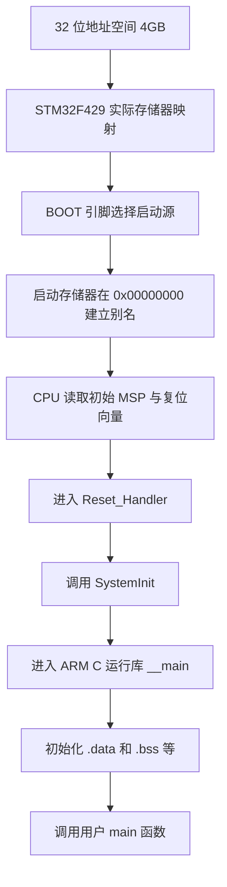
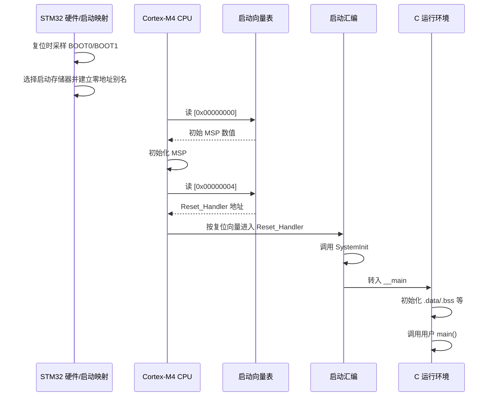
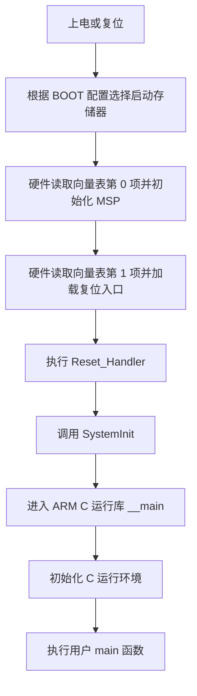
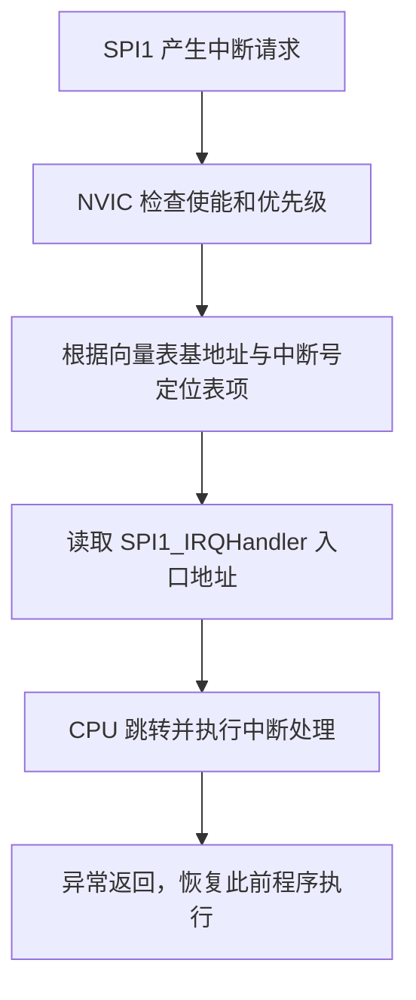
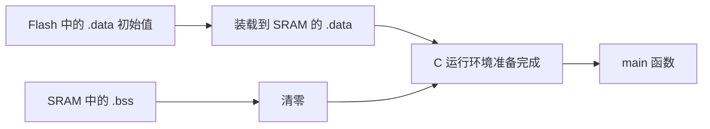

# STM32F429 存储器映射、BOOT 启动方式与启动文件——完整知识讲义

> **教学平台**：野火 STM32F429IGT6（Cortex-M4）  
> **开发环境**：STM32CubeMX + Keil MDK-ARM / Keil5  
> **核心材料**：本次对话中提供的两张图（Cortex-M3 地址空间图、BOOT 启动模式表）以及 `startup_stm32f429xx.s` 启动文件。  
> **文档定位**：把“CPU 地址空间 → 片内实际存储器 → 启动模式 → 零地址映射 → 向量表 → 汇编启动 → C 运行时 → main()”连成一条完整逻辑链。  
> **说明**：图片中的第一张图是 **Cortex-M3** 通用存储器映射图；本讲义使用相近的 Cortex-M 系列基本布局解释原理，具体实例均以 **STM32F429 的 Cortex-M4** 为准。

## 学习目标与路线

学完后，应能够独立解释：

1. “32 位单片机有 4 GB 地址空间”与“片上只有 1 MB Flash、256 KB SRAM”为什么不矛盾。
2. Flash、SRAM、外设、核心调试/控制寄存器、CCM RAM 分别映射到哪里。
3. BOOT0、BOOT1 如何决定主 Flash、系统存储器、SRAM 三种启动模式。
4. 为什么程序放在 `0x08000000`，CPU 却先从 `0x00000000` 读取启动向量。
5. 上电瞬间 MSP、PC 的初始化与 `Reset_Handler` 的执行先后关系。
6. `startup_stm32f429xx.s` 中各段 ARM 汇编的用途，包括堆栈、向量表、弱中断处理和 C 运行库衔接。
7. 如何通过 Keil5 的 Memory、Disassembly、Registers 窗口验证上述结论。



---

## 第一篇：32 位地址空间与 ARM Cortex-M 存储器映射

### 1.1 什么是“存储器映射”？

CPU 要访问 Flash 中的代码、SRAM 中的变量和 GPIO/SPI/UART 的寄存器，都需要通过**地址**定位对象。ARM 为 Cortex-M 内核定义了统一的地址空间；具体芯片厂商再决定其中哪些地址真实对应硬件。

32 位寻址理论上可表示：

\[
2^{32}=4,294,967,296\ \mathrm{Byte}=4\ \mathrm{GiB}
\]

地址范围：

```text
0x00000000 ~ 0xFFFFFFFF
```

**重要区别**：4 GB 是可编码的**地址范围**，不是芯片内部真实配置的 Flash 或 SRAM 容量。许多地址可能是保留区，访问并不一定有效。

### 1.2 读懂第一张图：Cortex-M 的六大区域

按照第一张图从低地址到高地址的主要分区：

| 区域 | 地址范围 | 理论跨度 | 图中的用途 | 对 STM32F429 的理解 |
|---|---|---:|---|---|
| Code | `0x00000000`—`0x1FFFFFFF` | 512 MiB | 代码区 | 其中有启动别名区、主 Flash 和系统存储器等；实际实现远小于 512 MiB |
| SRAM | `0x20000000`—`0x3FFFFFFF` | 512 MiB | 片上/数据 RAM 区 | 实际 SRAM1/2/3 占用一小部分 |
| Peripheral | `0x40000000`—`0x5FFFFFFF` | 512 MiB | 外设空间 | GPIO、RCC、USART、SPI、定时器寄存器等 |
| External RAM | `0x60000000`—`0x9FFFFFFF` | 1 GiB | 外部 RAM 地址区 | 供外部存储控制器相关映射使用，实际连接和可用范围依具体芯片/电路 |
| External device | `0xA0000000`—`0xDFFFFFFF` | 1 GiB | 外部设备区 | 如外部设备或外部存储控制器映射的部分区域 |
| System | `0xE0000000`—`0xFFFFFFFF` | 512 MiB | 系统/内核私有外设/厂商区 | NVIC、SysTick、调试单元等部分位于此区 |

> 术语提示：本表的“1 GiB = 1024 MiB”，与原图标注的 1.0 GB 对应的是二进制地址跨度。不能根据大框面积判断具体 MCU 的存储容量。

直观地看这张图，**左侧图示某个大区域的细节，右侧则是整个 4 GB 地址空间**。例如原图将 `0xE0000000` 附近进一步拆分成 ITM、DWT、FPB、NVIC、TPIU、ETM 等调试或内核组件。

### 1.3 Cortex-M3 与 STM32F429 Cortex-M4 的关系

- 图题写的是 Cortex-M3，适用于理解 Cortex-M 系列统一的基本地址划分。
- 野火 STM32F429IGT6 实际内核为 **Cortex-M4（带 FPU）**。
- Cortex-M4 在异常处理、地址映射、位带概念等方面与 Cortex-M3 有很多共同基础。
- 但 F429 的 Flash 容量、SRAM 分块、CCM RAM 和具体外设基地址，必须依据 **STM32F429 参考手册 RM0090**，不能简单把 M3 的示意图当作 F429 器件存储器容量表。

### 1.4 什么是存储器映射 I/O（Memory-Mapped I/O）？

STM32 的外设寄存器也占用普通的 32 位地址空间。CPU 读写特定地址，就相当于读写外设寄存器。

例如 STM32F429 的 GPIOA 基地址为 `0x40020000`，GPIOA 输出数据寄存器 ODR 相对偏移为 `0x14`：

```c
#include <stdint.h>

#define GPIOA_BASE  (0x40020000UL)
#define GPIOA_ODR   (*(volatile uint32_t *)(GPIOA_BASE + 0x14UL))

/* 仅示范寄存器地址访问：实际操作前还应开启 GPIOA 时钟并设置模式 */
GPIOA_ODR |= (1UL << 5);
```

可以理解为：

```text
CPU 执行寄存器写入指令
           ↓
目标地址 0x40020014
           ↓
片上总线 / 地址译码
           ↓
GPIOA 的 ODR 硬件寄存器
```

`volatile` 是重要限定符：告知编译器该地址所对应的数据可能因硬件和其他执行路径发生变化，不应按普通内存变量随意省略访问。

**实际 GPIO 置位/清零更推荐使用 GPIOx_BSRR**，它能避免对 ODR 读-改-写所带来的并发风险。上面的例子只是为理解“外设寄存器 = 地址映射”而写。

### 1.5 Cortex-M 内核系统控制区

在 `0xE0000000` 开始的区域中，原图列出了这些名称：

| 缩写 | 主要名称与作用 | 学习重点 |
|---|---|---|
| ITM | Instrumentation Trace Macrocell | 软件跟踪/调试输出 |
| DWT | Data Watchpoint and Trace | 数据观察点、部分性能计数/跟踪 |
| FPB | Flash Patch and Breakpoint | 断点/调试支持 |
| NVIC | Nested Vectored Interrupt Controller | 中断使能、优先级、嵌套处理 |
| TPIU | Trace Port Interface Unit | 跟踪输出接口 |
| ETM | Embedded Trace Macrocell | 指令跟踪，具体是否实现依芯片而定 |
| ROM Table | 调试组件发现表 | 调试器识别 CoreSight 组件 |

例如：

- SysTick 控制寄存器 `SYST_CSR` 在 `0xE000E010`。
- NVIC 中断使能寄存器 `NVIC_ISER0` 在 `0xE000E100`。

这些地址代表**CPU 内核级功能**，并非 GPIO、SPI 等普通 STM32 厂商外设的地址区。

### 1.6 Bit Band（位带）原理

原图右下角展示两组位带区域：

| 对象 | 真实位带区（1 MiB） | 位带别名区（32 MiB） |
|---|---|---|
| SRAM | `0x20000000`—`0x200FFFFF` | `0x22000000`—`0x23FFFFFF` |
| 外设 | `0x40000000`—`0x400FFFFF` | `0x42000000`—`0x43FFFFFF` |

位带的本质是把目标区域中的**一个 bit** 映射到别名区域中的**一个 32 位字**。向别名地址写入 `0` 或 `1`，可以操作相应的目标 bit。

SRAM 位带别名计算公式：

\[
\mathrm{Alias}=0x22000000+(\mathrm{ByteAddress}-0x20000000)\times32+\mathrm{BitNumber}\times4
\]

例如 `0x20000000` 中的 bit3：

```text
Alias = 0x22000000 + 0 × 32 + 3 × 4
      = 0x2200000C
```

示范代码（仅用于理解 Cortex-M4 位带功能）：

```c
#define SRAM_BIT3_ALIAS (*(volatile uint32_t *)0x2200000CUL)
SRAM_BIT3_ALIAS = 1U; // 将 0x20000000 处字节中的 bit3 置位
SRAM_BIT3_ALIAS = 0U; // 将该位清零
```

**不要误解**：32 MiB 位带别名区不是新增的 32 MiB 物理 RAM，而是同一位带区域的另一种访问路径。并非所有新款 Cortex-M 内核都提供位带，教学时以本芯片为准。

**与 GPIO 的关系**：虽然外设位带可用于某些单比特操作，但 GPIO 输出引脚通常优先使用 BSRR，因为它专门面向 GPIO 原子置位/清零。

---

## 第二篇：STM32F429 的真实存储器地图

### 2.1 “架构预留地址”和“芯片实际实现”要分开

以本次采用的 **STM32F429IGT6** 为例，典型规格为：

- 主 Flash：**1 MiB**，用于非易失性保存程序及常量；
- SRAM：合计 **256 KiB**，其中普通系统 SRAM 为 192 KiB（112+16+64），另有 **64 KiB CCM 数据 RAM**；
- 另有备用域 SRAM 等特定用途存储器，不与上述普通系统 RAM 混为一谈。

这些数值是实芯片容量，不能用第一张图中的“Code 0.5 GB、SRAM 0.5 GB”替代。

### 2.2 关键地址表（教学速查）

| 存储器/组件 | 起始地址 | 主要说明 |
|---|---|---|
| 启动别名区 | `0x00000000` | 根据 BOOT 配置，可映射到选定的启动存储器 |
| 主 Flash | `0x08000000` | 正常用户程序一般从这里链接、烧录 |
| CCM RAM | `0x10000000` | 64 KiB，紧耦合数据 RAM，主要由 CPU 访问 |
| System memory | `0x1FFF0000` | ST 预置系统 Bootloader 所在的片内 ROM 区域 |
| SRAM1 | `0x20000000` | 112 KiB，直到 `0x2001BFFF` |
| SRAM2 | `0x2001C000` | 16 KiB，直到 `0x2001FFFF` |
| SRAM3 | `0x20020000` | 64 KiB，直到 `0x2002FFFF` |
| GPIOA | `0x40020000` | GPIOA 外设寄存器基地址 |
| 内核 PPB 相关区 | `0xE0000000` 起的部分地址 | NVIC、SysTick、调试组件等 |

> **CCM RAM 特别注意**：F429 的 64 KiB CCM 不在普通 AHB 总线矩阵上，不能直接作为通用 DMA 缓冲区。使用 DMA（例如 SPI DMA / ADC DMA）时，应把数据缓冲区放在 DMA 能访问的 SRAM 区域。

### 2.3 Flash、SRAM 与 CPU 分别做什么？

| 对象 | 断电保留？ | 典型放置内容 | 常见访问主体 |
|---|---|---|---|
| 主 Flash | 是 | 程序指令、常量、初始数据映像 | CPU，Flash 编程控制器 |
| SRAM1/2/3 | 否（通常） | 全局变量、栈、堆、DMA 缓冲区 | CPU、DMA、部分外设总线主设备 |
| CCM RAM | 否（通常） | 对时延敏感的 CPU 数据 | CPU，不适合 DMA 直接访问 |
| System memory | 是（出厂预置） | ST 内置 Bootloader | CPU 执行启动代码 |

注意：`0x20000000` 是普通 SRAM 的起点，但并不意味着 F429 所有 RAM 都在 `0x20000000` 之后；例如 CCM 位于 `0x10000000`。

### 2.4 Keil 的 IROM1 / IRAM1 是什么？

在一个最常见的 STM32F429IGT6 工程中，Keil 的存储器配置可能是：

| 项目 | 常见起始地址 | 常见大小 | 用途 |
|---|---|---:|---|
| IROM1 | `0x08000000` | `0x00100000`（1 MiB） | 可执行程序和只读数据的存放区域 |
| IRAM1 | `0x20000000` | `0x00030000`（192 KiB） | 常规全局变量、栈、堆等 |

这只是**示例配置**，真实工程应以芯片型号、scatter 文件及项目设置为准。CCM RAM 的 64 KiB 通常需要独立考虑，不能因为“SRAM 总共 256 KiB”就把 IRAM1 从 `0x20000000` 简单扩大为 256 KiB。

### 2.5 程序区、数据区、外设区如何协作？

以下是典型的嵌入式程序：

```c
const uint8_t table[3] = {1, 2, 3};  // 通常位于 Flash 的只读段
uint32_t count = 100;               // RAM .data，初始值保存在 Flash 映像
uint8_t rx_buffer[128];             // RAM .bss，启动时清零

int main(void)
{
    uint32_t local = 0;             // 可能使用栈或寄存器
    while (1) {
        local++;
        count++;
    }
}
```

- 程序指令（`.text`）和常量（如 `.rodata`）一般位于 Flash。
- 有初始值的可写全局变量位于 RAM 的 `.data`，启动时加载初始值。
- 未初始化的全局变量位于 RAM 的 `.bss`，启动时清零。
- 函数局部变量根据编译优化可能使用寄存器或栈。
- CPU 向外设寄存器写入数据，不等同于向 SRAM 普通变量赋值，但编程层面都通过地址访问。

---

## 第三篇：BOOT 启动模式、地址别名和上电复位

### 3.1 什么是“启动模式”？

CPU 复位后必须确定**从哪一块存储器取复位向量及后续启动代码**。STM32F429 支持通过 BOOT0、BOOT1 选择基本启动方式。

这里的 BOOT 并不是“编译选项”，而是复位时由硬件采样的启动配置。芯片正常执行用户程序时，使用的通常是主 Flash 启动方式。

### 3.2 第二张图：BOOT0 / BOOT1 对应关系

| BOOT1 | BOOT0 | 选择的启动源 | 主要用途 |
|---:|---:|---|---|
| X | 0 | 主 Flash（Main Flash memory） | 平常调试、量产应用、上电执行用户程序 |
| 0 | 1 | 系统存储器（System memory） | 进入 ST 出厂 Bootloader，按支持的通信方式下载固件 |
| 1 | 1 | 嵌入式 SRAM（Embedded SRAM） | 特殊测试、RAM 运行/调试场景 |

`X` 的意思是“无关”：只要 BOOT0=0，BOOT1 的值不会改变所选启动模式。

**与 BOOT1 相比，BOOT0 的影响更直观**：BOOT0=0 时优先选择普通主 Flash 启动；BOOT0=1 后再由 BOOT1 区分系统存储器还是 SRAM。

STM32F429 传统启动方式的 BOOT1 逻辑与器件引脚复用有关；具体板卡用拨码开关、跳线还是电阻配置，必须结合**野火开发板原理图**确定，不能从 BOOT 表中推断板子某个跳帽当前一定是什么电平。

### 3.3 模式一：主 Flash 启动

```text
BOOT0 = 0
      ↓
选择主 Flash
      ↓
用户程序通常链接到 0x08000000
      ↓
复位后加载启动向量并执行用户程序
```

主 Flash 是非易失性存储器，断电后代码通常仍保留。Keil 下载、ST-Link 烧录、日常运行 LED/USART/SPI 实验代码，都是这类情形。

### 3.4 模式二：系统存储器启动（ST Bootloader）

```text
BOOT0 = 1, BOOT1 = 0
           ↓
选择 System memory
           ↓
执行 ST 出厂预置 Bootloader
           ↓
通过芯片支持的接口/协议接收并写入用户程序
```

**这与 `startup_stm32f429xx.s` 不是一回事**：

| 对象 | 内置 Bootloader | 用户工程启动文件 |
|---|---|---|
| 谁提供 | ST 在芯片出厂时预置 | ST 例程/CubeMX 工程模板，参与用户项目编译 |
| 通常存在哪里 | System memory | 编译生成的用户固件，通常在 Main Flash |
| 主要任务 | 通信下载/更新固件等 | 建立向量表，进入用户 C 程序 |
| 是否直接是 `main()` 前的汇编代码 | 不是 | 是用户固件启动的重要部分 |

STM32 系统 Bootloader 支持哪些 USART/CAN/USB 或其他接口，取决于**具体器件及其 Bootloader 版本**，不能仅凭“STM32F4”泛化。查 ST **AN2606** 及对应版本的引脚/接口表是正确做法。

ST-Link 通过 SWD/JTAG 下载程序的机制，和把 BOOT0 拉高进入片内 Bootloader，并不是同一种下载路径。

### 3.5 模式三：SRAM 启动

```text
BOOT0 = 1, BOOT1 = 1
           ↓
选择嵌入式 SRAM 作为启动源
           ↓
要求 RAM 中已放置可启动的向量表及代码
```

SRAM 通常断电丢失数据。该模式不能简单理解为“把 BOOT0/BOOT1 都拨到 1，就能自动运行 Flash 中的代码”，也不能不经过装载就依赖其中存在有效程序。

需要注意实际地址别名映射的是 **SRAM1 起始区域**。若要在 SRAM 中正确响应异常/中断，通常还需要正确设置向量表的 VTOR 基地址。

### 3.6 为什么会出现 `0x00000000`？

这是两张图联系的核心：

**主 Flash 的物理访问地址在 `0x08000000`，但是 Cortex-M 内核复位时，要从启动别名窗口 `0x00000000` 读取初始向量信息。**

STM32 通过**地址别名（aliasing）/启动映射**让选中的存储器同时可以通过零地址访问。

| 启动模式 | 被选存储器的常用实际地址 | 复位时的起始别名地址 |
|---|---|---|
| Main Flash | `0x08000000` | `0x00000000` |
| System memory | `0x1FFF0000` | `0x00000000` |
| Embedded SRAM | `0x20000000`（SRAM1 起始） | `0x00000000` |

例如，主 Flash 启动时：

```text
CPU 读 0x00000000        CPU 读 0x08000000
        │                        │
        └────────┬───────────────┘
                 ▼
         同一主 Flash 起始内容
```

**不是复制**：STM32 不需要上电时把整个程序从 `0x08000000` 拷贝到 `0x00000000`。这是**地址译码和映射方式**。原始 Flash 地址在启动别名生效后，仍然可直接访问。

### 3.7 复位时 CPU 实际读取的是什么？

它不是先“从 0x00000000 执行一条程序指令”，而是先读取**启动向量表的前两个字**：

| 启动别名地址 | 主 Flash 模式下对应位置 | 实际含义 |
|---|---|---|
| `0x00000000` | `0x08000000` | 初始 **MSP**（Main Stack Pointer，主栈指针）数值 |
| `0x00000004` | `0x08000004` | **Reset_Handler** 入口地址（复位向量） |
| `0x00000008` | `0x08000008` | NMI 异常处理入口 |
| `0x0000000C` | `0x0800000C` | HardFault 异常处理入口 |

注意两个层次：

1. `0x08000004` 是存放“地址值”的位置。
2. 存放的地址值指向 `Reset_Handler` 真正的代码所在位置；**`Reset_Handler` 的机器指令本身并不就在 `0x08000004` 这个表项中**。

由于 Cortex-M 采用 Thumb 指令集，向量表中函数入口地址的最低位一般为 `1`，它表示 Thumb 状态，并不是把字节地址故意放错一位。观察反汇编时，实际指令地址与存储的入口值的最低位可能表现不同。

### 3.8 用一条完整时序串联两张图



### 3.9 BOOT 选择与 VTOR 的关系

`BOOT0/BOOT1` 主要解决“**刚复位时谁映射到零地址**”；VTOR（向量表偏移寄存器）用于决定“**当前异常/中断向量表从哪里读取**”。两者不是同一个配置对象。

- 普通用户固件：向量表通常在 `0x08000000`，可由系统初始化设置 VTOR 到这个地址。
- 自定义 Bootloader 跳转 App：如果 App 在 `0x08020000` 等非默认位置，通常要将 VTOR 指向 App 的向量表，并正确处理 MSP、复位入口及中断状态。
- SRAM 启动：程序需要有效的 RAM 向量表，运行时往往也需要把 VTOR 设置到 RAM 向量表的实际地址。

**不要直接把“BOOT0=1”等同于 VTOR=0x1FFF0000**。一个是启动源选择，一个是向量表基地址配置，它们发生的阶段与控制方式不同。

---

## 第四篇：汇编启动文件 `startup_stm32f429xx.s` 逐段详解

### 4.1 认识 STM32 启动文件

`startup_stm32f429xx.s` 是 STM32F429 使用的 ARM 汇编启动文件，适用于 Keil MDK-ARM 工具链。

结合 STM32 存储器映射和 BOOT 启动模式，本节要回答：**STM32 上电之后，在执行我们编写的 `main()` 函数之前，究竟做了哪些事情？**

首先区分两个容易混淆的概念：

- **芯片内置 Bootloader**：由 ST 预先写入系统存储器，供某些接口下载用户程序使用。
- **用户工程启动文件**：编译进用户程序中，通常随程序存储在主 Flash 中，定义向量表、复位入口和默认中断处理等内容。

#### 4.1.1 启动文件的六个主要部分

| 部分 | 关键内容 | 作用 |
|---|---|---|
| ① 栈配置 | `Stack_Size` | 预留运行时栈空间 |
| ② 堆配置 | `Heap_Size` | 预留运行时堆空间 |
| ③ 中断向量表 | `__Vectors` | 存储初始 MSP 和中断处理函数入口地址 |
| ④ 复位处理程序 | `Reset_Handler` | 进入系统初始化和 C 运行时 |
| ⑤ 默认异常/中断处理 | `Default_Handler` | 为未实现的中断提供默认处理 |
| ⑥ 堆栈运行库接口 | `__user_initial_stackheap` | 向 ARM C 运行库提供堆栈边界 |

#### 4.1.2 STM32 上电到 main 的主要流程



**注意**：硬件先加载 MSP 和复位入口，之后才执行启动文件中的汇编指令；`Stack_Size` 等内容是汇编器/链接器使用的数据定义，并不是 CPU 上电后逐行执行的设置动作。

---

### 4.2 第一部分：栈 Stack 的定义

启动文件原代码：

```asm
Stack_Size      EQU     0x400

                AREA    STACK, NOINIT, READWRITE, ALIGN=3
Stack_Mem       SPACE   Stack_Size
__initial_sp
```

#### 4.2.1 `Stack_Size EQU 0x400`

`EQU` 是汇编中的符号定义指令，类似于 C 语言的常量定义：

```c
#define Stack_Size 0x400
```

这里：

\[
0x400 = 1024\ \text{Bytes} = 1\ \text{KB}
\]

也就是说，本启动文件默认预留 **1 KB 栈空间**。这个值不是 STM32F429 的硬件限制，而是工程配置，可以根据应用需要调整。

#### 4.2.2 `AREA STACK, NOINIT, READWRITE, ALIGN=3`

`AREA` 用于定义一个段：

| 参数 | 含义 |
|---|---|
| `STACK` | 段名称 |
| `NOINIT` | 不要求装载时初始化段内容 |
| `READWRITE` | 可读写区域 |
| `ALIGN=3` | 按 `2^3 = 8` 字节对齐 |

栈通常分配在 SRAM 中。`NOINIT` 不意味着不能使用这段内存，而是指无需为其装载固定初始数据。

#### 4.2.3 `Stack_Mem SPACE Stack_Size`

`SPACE` 用于预留空间：

```asm
Stack_Mem       SPACE   Stack_Size
```

即预留 1024 字节，`Stack_Mem` 标签指向这段空间的低地址端。

#### 4.2.4 `__initial_sp` 与栈增长方向

`__initial_sp` 是一个标签，位于预留栈空间之后，所以标记其高地址端。

Cortex-M4 的主栈通常采用**满递减栈**，也就是说，压栈操作会使栈指针向低地址方向移动：

```text
       高地址
          ┌───────────────────────┐
          │ __initial_sp          │ ← 初始 MSP
          ├───────────────────────┤
          │                       │
          │  预留的 1024B 栈空间  │
          │                       │
          │  栈向低地址增长 ↓     │
          ├───────────────────────┤
          │ Stack_Mem             │
          └───────────────────────┘
       低地址
```

例如，假设栈指针最初为 `0x20020000`，压入一个 32 位数据后，MSP 通常减小 4 字节，变为 `0x2001FFFC`。

**总结**：`__initial_sp` 是供向量表引用的初始主栈指针符号；实际数值由链接器决定。

---

### 4.3 第二部分：堆 Heap 的定义

启动文件原代码：

```asm
Heap_Size       EQU     0x200

                AREA    HEAP, NOINIT, READWRITE, ALIGN=3

__heap_base
Heap_Mem        SPACE   Heap_Size
__heap_limit
```

`0x200 = 512 Bytes`，即默认预留 **512 B 堆空间**。

- `__heap_base`：堆的起始边界。
- `Heap_Mem`：为堆预留空间。
- `__heap_limit`：堆的结束边界。

#### 4.3.1 堆和栈的区别

| 对比项 | Stack（栈） | Heap（堆） |
|---|---|---|
| 管理方式 | 通常由编译器和运行时管理 | 由动态内存分配器管理 |
| 典型用途 | 函数调用、自动局部变量等 | `malloc()` 等动态分配 |
| 典型回收方式 | 函数返回时恢复栈指针 | 使用 `free()` 等释放 |
| 本文件默认大小 | 1 KB | 512 B |

示例：

```c
#include <stdlib.h>

void Test(void)
{
    int a = 100;
    int *p = malloc(100);

    if (p != NULL)
    {
        /* 使用动态申请的内存 */
        free(p);
    }
}
```

- 局部变量 `a` 在常见未优化实现中可能存放于栈中，编译器也可能把它放在寄存器中。
- `p` 是局部指针变量；`malloc(100)` 申请的空间来自动态内存管理区域。
- 全局变量、静态变量不因在函数中被使用就存储于栈中。

**关键认识**：堆和栈不是两种独立的物理存储器，通常都使用 SRAM，只是内存管理方式不同。

---

### 4.4 第三部分：汇编环境设置

```asm
PRESERVE8
THUMB
```

#### 4.4.1 `PRESERVE8`

声明代码遵循 8 字节栈对齐相关的调用约定，帮助不同函数和模块之间正确协作。

这是汇编器声明，并不是运行时执行“把 SP 对齐”的指令。

#### 4.4.2 `THUMB`

告诉汇编器后续代码按照 Thumb 指令集汇编。

STM32F429 使用 ARM Cortex-M4 内核，运行 Thumb/Thumb-2 指令，不执行传统 ARM 状态指令。

---

### 4.5 第四部分：中断向量表 `__Vectors`

这是启动文件最重要的组成部分之一，直接联系到前面讲过的启动地址映射。

#### 4.5.1 向量表的定义

```asm
AREA    RESET, DATA, READONLY

EXPORT  __Vectors
EXPORT  __Vectors_End
EXPORT  __Vectors_Size

__Vectors
        DCD     __initial_sp
        DCD     Reset_Handler
        DCD     NMI_Handler
        DCD     HardFault_Handler
        DCD     MemManage_Handler
        DCD     BusFault_Handler
        DCD     UsageFault_Handler
        DCD     0
        ...
        DCD     SysTick_Handler
```

`AREA RESET, DATA, READONLY` 定义一个只读数据段来存储向量表；它不是可执行指令段。

`EXPORT` 将符号导出，供其他模块和链接器使用。

#### 4.5.2 `DCD` 是什么？

`DCD` 是 ARM 汇编伪指令，用于定义 32 位数据：

```asm
DCD 0x12345678
```

当写成：

```asm
DCD Reset_Handler
```

时，意思是**把 `Reset_Handler` 的入口地址保存到向量表中**，不是立即调用此函数。

#### 4.5.3 主 Flash 启动时的向量表布局

若向量表位于 `0x08000000`，常见布局为：

| Flash 地址 | 存放内容 | 用途 |
|---|---|---|
| `0x08000000` | `__initial_sp` 的值 | 初始化 MSP |
| `0x08000004` | `Reset_Handler` 地址 | 复位入口 |
| `0x08000008` | `NMI_Handler` 地址 | NMI 异常 |
| `0x0800000C` | `HardFault_Handler` 地址 | HardFault 异常 |
| `0x08000010` | `MemManage_Handler` 地址 | 内存管理异常 |
| `0x08000014` | `BusFault_Handler` 地址 | 总线错误异常 |
| `0x08000018` | `UsageFault_Handler` 地址 | 用法错误异常 |
| `0x0800001C` | 0 | 保留 |
| `...` | `...` | `...` |
| `0x0800003C` | `SysTick_Handler` 地址 | SysTick 异常 |
| `0x08000040` | `WWDG_IRQHandler` 地址 | 第一个外部中断向量 |

**重点**：例如 `0x08000004` 地址处存放的是复位处理函数的**地址值**，不是它的第一条指令。

#### 4.5.4 为什么向量表中列出了这么多中断？

```asm
DCD     EXTI0_IRQHandler
DCD     TIM2_IRQHandler
DCD     TIM3_IRQHandler
DCD     I2C1_EV_IRQHandler
DCD     SPI1_IRQHandler
DCD     SPI2_IRQHandler
DCD     USART1_IRQHandler
```

这些表项对应 STM32 的外设中断入口，例如：

- `EXTI0_IRQHandler`：外部中断线 0。
- `TIM2_IRQHandler`：TIM2 定时器中断。
- `SPI1_IRQHandler`：SPI1 中断。
- `USART1_IRQHandler`：USART1 串口中断。

CPU 接收到并允许响应某个中断时，会通过当前中断向量表读取对应处理函数地址并跳转执行。

#### 4.5.5 以 SPI1 中断计算向量表地址

在 STM32F429 中，SPI1 的外部中断号是 **35**。Cortex-M 向量表前面有 **16 项内核异常向量**，因此：

\[
\text{SPI1 向量表项索引}=16+35=51
\]

每项占 4 字节：

\[
51\times4=204=0xCC
\]

如果向量表基地址为 `0x08000000`，则 SPI1 对应表项地址为：

```text
0x08000000 + 0xCC = 0x080000CC
```

该地址存放的是 `SPI1_IRQHandler` 函数的入口地址。



HAL 工程中的中断入口可能写为：

```c
void SPI1_IRQHandler(void)
{
    HAL_SPI_IRQHandler(&hspi1);
}
```

请注意：仅在向量表中定义入口不等于中断已开启；还必须按需要配置外设中断源、NVIC 等。

#### 4.5.6 向量表结束位置和大小

```asm
__Vectors_End
__Vectors_Size  EQU  __Vectors_End - __Vectors
```

- `__Vectors_End`：向量表结束位置。
- `__Vectors_Size`：向量表长度，用结束地址减去起始地址计算。

---

### 4.6 第五部分：`Reset_Handler` 复位处理函数

完整关键代码：

```asm
Reset_Handler    PROC
                 EXPORT  Reset_Handler   [WEAK]
                 IMPORT  SystemInit
                 IMPORT  __main

                 LDR     R0, =SystemInit
                 BLX     R0
                 LDR     R0, =__main
                 BX      R0
                 ENDP
```

虽然只有几条指令，却连接了硬件复位、系统初始化和 C 语言程序。

#### 4.6.1 `PROC` 与 `ENDP`

```asm
Reset_Handler PROC
...
ENDP
```

表示定义一个汇编过程，可类比一个函数的开始和结束。

#### 4.6.2 `EXPORT Reset_Handler [WEAK]`

- `EXPORT`：将符号导出。
- `[WEAK]`：定义为弱符号；若链接时有同名的强符号定义，可由其覆盖。

正常情况下，当前启动文件中的 `Reset_Handler` 就是程序的复位入口。

#### 4.6.3 `IMPORT SystemInit` 和 `IMPORT __main`

这两个符号由其他模块提供，不在本启动文件中实现。

**`SystemInit()`**：通常定义在 `system_stm32f4xx.c` 中，负责早期系统配置，如 RCC 相关初始设置、必要的向量表相关处理等。具体操作与固件版本和工程配置有关。

**`__main`**：ARM C 运行库入口，不等于用户定义的 `main()`。用于完成 C 程序运行前的必要初始化，并最终进入 `main()`。

#### 4.6.4 四条指令逐条理解

第一条：

```asm
LDR R0, =SystemInit
```

把 `SystemInit` 的函数地址装入 R0 寄存器，**此时尚未调用函数**。

第二条：

```asm
BLX R0
```

跳转到 R0 指向的函数，并设置返回地址；可理解成执行 `SystemInit()`。函数返回后，继续执行下面的指令。

第三条：

```asm
LDR R0, =__main
```

将 C 运行库入口 `__main` 的地址装入 R0。

第四条：

```asm
BX R0
```

跳转至 `__main`，不额外保存新的返回地址。这里是向 C 运行库移交执行流程。

#### 4.6.5 为什么不直接跳转 `main()`？

看一个 C 程序：

```c
int counter = 100;
int flag;

int main(void)
{
    while (1)
    {
        counter++;
    }
}
```

`counter` 是有初始值的全局变量；`flag` 是未显式初始化的全局变量，按 C 语言规则初始值应为 0。

CPU 刚复位时，RAM 中的对应位置不一定已经满足这些 C 语言要求。所以典型启动过程需要：

1. 把已初始化的可读写数据从 Flash 中的初始映像装载到 RAM。
2. 将未初始化数据区（通常是 `.bss`）清零。
3. 进行必要的 C 运行时初始化。
4. 最终调用用户的 `main()`。



因此，不能随意将 `__main` 改成直接调用用户 `main()`。

**另外一个重要顺序**：当前启动文件先调用 `SystemInit`，再进入 C 运行库 `__main`。因此早期 `SystemInit` 不应随意依赖尚未正确初始化的普通全局变量。

---

### 4.7 第六部分：默认中断处理与弱符号

#### 4.7.1 `B .` 是什么？

```asm
NMI_Handler     PROC
                EXPORT NMI_Handler [WEAK]
                B .
                ENDP
```

- `B`：无条件跳转。
- `.`：当前位置。

因此 `B .` 的效果就是停在当前位置形成死循环：

```c
while (1)
{
}
```

当异常发生而程序没有提供合适的处理逻辑时，默认处理程序停在这里，可以通过调试器定位问题。

#### 4.7.2 `Default_Handler` 为什么列出多个名字？

原文件中有大量类似：

```asm
Default_Handler PROC

                EXPORT SPI1_IRQHandler   [WEAK]
                EXPORT USART1_IRQHandler [WEAK]
                EXPORT TIM2_IRQHandler   [WEAK]

                ...

SPI1_IRQHandler
USART1_IRQHandler
TIM2_IRQHandler

                ...

                B .
                ENDP
```

这些默认中断入口被定义为弱符号。如果用户没有提供相应的中断函数，那么该中断可能进入默认的死循环处理。

当用户在 `stm32f4xx_it.c` 中提供与启动文件完全同名的中断函数时：

```c
void SPI1_IRQHandler(void)
{
    HAL_SPI_IRQHandler(&hspi1);
}
```

链接器会采用用户提供的强符号定义，从而将向量表中的入口关联到用户的中断函数。

**因此，通常无须修改汇编向量表，只需在 C 文件中实现正确命名的中断服务函数。**

---

### 4.8 最后一部分：C 运行库的堆栈初始化接口

原代码：

```asm
IF      :DEF:__MICROLIB

    EXPORT  __initial_sp
    EXPORT  __heap_base
    EXPORT  __heap_limit

ELSE

    IMPORT  __use_two_region_memory
    EXPORT  __user_initial_stackheap

__user_initial_stackheap

    LDR     R0, = Heap_Mem
    LDR     R1, =(Stack_Mem + Stack_Size)
    LDR     R2, =(Heap_Mem + Heap_Size)
    LDR     R3, = Stack_Mem
    BX      LR

    ALIGN

ENDIF
END
```

这部分是**条件汇编与运行库接口**，不是复位后主执行流程的一部分。

#### 4.8.1 使用 MicroLIB 时

导出：

```asm
__initial_sp
__heap_base
__heap_limit
```

供 MicroLIB 使用。Keil 中的 **Use MicroLIB** 选项与此条件汇编有关。

#### 4.8.2 不使用 MicroLIB 时

实现 `__user_initial_stackheap`，为 ARM C 运行库提供堆栈边界：

| 寄存器 | 内容 |
|---|---|
| `R0` | 堆起始位置 |
| `R1` | 栈的高地址端 |
| `R2` | 堆的结束位置 |
| `R3` | 栈的低地址端 |

`BX LR` 表示返回调用方。

运行时堆管理的实际实现还取决于 ARM 编译器、C 库版本和链接配置。

---

### 4.9 Keil5 调试实验：验证启动文件

实验平台：野火 STM32F429 开发板，使用 ST-Link 或板载兼容调试器，准备一个可编译和下载的工程。

#### 实验一：查看中断向量表

**操作步骤：**

1. 编译并下载工程，进入 Keil Debug。
2. 打开 **Memory** 窗口。
3. 输入地址 `0x08000000`。
4. 查看前 8 个字节对应的两个 32 位数据。

**观察结果：**

- `0x08000000`：初始主栈指针 MSP 值，一般位于有效 RAM 地址范围内。
- `0x08000004`：`Reset_Handler` 入口地址；最低位通常为 1，表示 Thumb 状态。

可以在反汇编或符号窗口找到 `Reset_Handler` 地址，再与向量表中的复位向量比较。

#### 实验二：单步执行 `Reset_Handler`

找到：

```asm
Reset_Handler PROC
    LDR R0, =SystemInit
    BLX R0
    LDR R0, =__main
    BX  R0
```

设置断点并复位运行，观察：

| 步骤 | 观察项 |
|---|---|
| 进入 `Reset_Handler` | PC 指向复位入口汇编代码 |
| 执行第一个 `LDR` | R0 得到 `SystemInit` 地址 |
| 执行 `BLX` | 跳转执行 `SystemInit` |
| `SystemInit` 返回 | 继续执行下一个 `LDR` |
| 执行 `BX` | 进入 ARM C 运行库 |
| 最终到达 `main` | 开始运行用户程序 |

如果源码级调试跳过部分库函数，可打开 **Disassembly** 反汇编窗口，进行指令级单步。

#### 实验三：查看 SPI1 中断向量

1. 在启动文件中找到 `DCD SPI1_IRQHandler`。
2. 在 `stm32f4xx_it.c` 中定位 `SPI1_IRQHandler()`。
3. 查看该中断函数的实际入口地址。
4. 在 Memory 窗口查看 `0x080000CC` 对应的 32 位表项。
5. 比较向量表中保存的值与函数入口地址。

流程关系：

```text
汇编启动文件定义向量表
          ↓
向量表列出 SPI1 中断入口
          ↓
用户在 C 文件中实现 SPI1_IRQHandler
          ↓
链接器解析最终函数地址
          ↓
CPU 响应 SPI1 中断并跳转执行
```

---

### 4.10 学习要求与知识体系总结

| 层次 | 学习要求 | 内容 |
|---|---|---|
| 基础 | 必须掌握 | 启动文件的作用、Stack、Heap、中断向量表 |
| 进阶 | 建议掌握 | `Reset_Handler`、`SystemInit`、`__main`、弱符号 |
| 深入 | 后续掌握 | 链接布局、VTOR、向量表重定位、IAP Bootloader |

整个 STM32 用户程序启动过程可归纳为：

```text
存储器地址映射
       ↓
BOOT 启动模式选择
       ↓
启动存储器映射到 0x00000000
       ↓
CPU 读取向量表，初始化 MSP 和复位入口 PC
       ↓
执行 Reset_Handler
       ↓
调用 SystemInit
       ↓
进入 C 运行库 __main
       ↓
初始化 C 程序运行环境
       ↓
进入 main()
       ↓
用户程序运行
```

最后要区分三层机制：

1. **硬件启动机制**：BOOT 配置、存储器映射、从向量表加载初始 MSP 和复位向量。
2. **汇编启动文件**：定义向量表、堆栈区域、复位处理程序、默认中断入口。
3. **C 运行时初始化**：初始化已定义数据和 BSS 等运行环境，然后进入用户 `main()`。

理解这三层后，再学习 NVIC、定时器中断、SPI 中断、RTOS 和 Bootloader 时，会更加容易建立完整的知识体系。

---

*说明：本文以用户提供的 `startup_stm32f429xx.s` 启动文件为基础整理，具体系统初始化和链接内存布局仍需结合对应工程中的 `system_stm32f4xx.c`、Keil Target 配置及编译器运行库版本检查。*


---

## 第五篇：把启动文件、HAL 和实际工程连接起来

### 5.1 为什么 `SystemInit()` 和 `SystemClock_Config()` 不是同一个函数？

在 STM32CubeMX 生成的常见 HAL 工程里，程序通常如下：

```c
int main(void)
{
    HAL_Init();
    SystemClock_Config();
    MX_GPIO_Init();
    MX_SPI1_Init();
    while (1) {
        /* 用户应用逻辑 */
    }
}
```

此时：

1. **`SystemInit()`**：由汇编的 `Reset_Handler` 调用，属于 `main()` 之前的早期系统初始化；
2. **`__main`**：ARM 运行库入口，完成 C 运行环境初始化，然后调用用户 `main()`；
3. **`HAL_Init()`**：由 `main()` 显式调用，用于 HAL 基础初始化，常包含 HAL 的 SysTick 时间基等操作；
4. **`SystemClock_Config()`**：由 `main()` 显式调用，按 CubeMX 配置选择 HSE/PLL/总线时钟等；
5. **`MX_SPI1_Init()`**：初始化 SPI1 等用户选定的外设。

**最常见误区**：看到 `Reset_Handler` 调用了 `SystemInit`，就认为 MCU 立刻按 CubeMX 配置运行在 180 MHz。这通常不对。实际主时钟切换、PLL 设置等往往在 `main()` 中的 `SystemClock_Config()` 完成，应检查工程代码，而不是从函数名字推断。

### 5.2 “程序烧录、链接地址、执行地址、启动别名地址”四个概念

| 概念 | 典型值 | 意义 |
|---|---|---|
| 代码烧录/存放位置 | `0x08000000` | 非易失性 Flash 的实际地址 |
| 链接器给向量表安排的地址 | `0x08000000` | 输出固件布局的地址 |
| 复位时的启动向量别名地址 | `0x00000000` | 内核用来读取初始 MSP 和复位向量的窗口 |
| `Reset_Handler` 的实际指令地址 | `0x0800xxxx`（示例） | CPU 从向量表取到这个入口地址之后执行代码 |

**重映射与运行库中的数据拷贝也不是同一件事**：

- 启动别名映射：让零地址窗口指向 Flash/System memory/SRAM，不是把整个程序搬走；
- `.data` 初始化：C 运行库为了让可写变量具备正确初始值，可能把 Flash 中的初始数据复制到 SRAM；
- Bootloader 接收固件：可能通过协议把新的代码编程进 Flash，这是固件更新，不是地址别名操作。

### 5.3 `__initial_sp`、`__Vectors` 与链接器的关系

启动文件会给出多个**符号标签**：

```asm
__initial_sp
__Vectors
__Vectors_End
__heap_base
__heap_limit
```

这些不是“固定写死的 SRAM 绝对地址”。汇编器先生成符号和段信息；链接器根据 Keil Target/Scatter（分散加载文件）把段安排到实际地址，最终才形成可烧录的映像。

这就是为什么修改 Keil 内存区域或链接脚本，可能改变栈/堆的位置，甚至改变程序的启动位置。

### 5.4 中断进入与中断返回还做了什么？

除了向量表跳转，Cortex-M4 的异常处理硬件还会自动保存/恢复必要的执行上下文（例如核心寄存器构成的异常栈帧；使用 FPU 时还存在相应扩展情形）。因此程序进入 `SPI1_IRQHandler()` 之前，CPU 会完成一系列硬件工作，不是普通 C 函数的直接调用。

这也是为什么：

- 主栈大小会影响异常处理的安全性；
- 中断函数不能无限递归或者使用过大的栈空间；
- 中断向量表、NVIC 和 ISR（中断服务函数）需要配合，缺一不可。

### 5.5 使用 SPI DMA 需要额外注意 CCM RAM

本教学平台有 64 KiB CCM RAM，但它不能作为普通 DMA 可直接访问的内存。因此学习 SPI DMA、ADC DMA、USART DMA 时，不能只看“指针是不是一个 SRAM 地址”，还要判断 DMA 能否到达该内存区域。

推荐的教学检查顺序：**数据缓冲区地址 → 所在 RAM 块 → DMA 可访问性 → 外设/DMA 配置 → 中断回调**。

---

## 第六篇：Keil5 验证实验与常见错误排查

> 第四篇已经提供向量表、Reset_Handler、SPI1 中断三个基础实验；这里再把它们扩展为一条可评分的完整实验任务，作为课堂练习或课后实验均可使用。

### 6.1 实验准备

- 野火 STM32F429IGT6 开发板，ST-Link/SWD 可正常连接；
- STM32CubeMX 建立最小工程，并由 Keil5 打开编译；
- 在 Keil 的 **Options for Target → Target** 核对 IROM1、IRAM1；
- 勾选生成调试信息，进入 Debug 模式；
- 保持 BOOT 配置为正常主 Flash 启动。

### 6.2 观察任务与判定标准

| 编号 | 调试任务 | 观察工具 | 应确认的结论 |
|---|---|---|---|
| T01 | 查看 `0x08000000` 处的前两个字 | Memory | 首字是 MSP 数值，次字是复位入口地址 |
| T02 | 对比 `0x00000000` 与 `0x08000000` | Memory | 主 Flash 启动别名可读到相同起始内容（取决于当前映射状态） |
| T03 | 进入 `Reset_Handler` | Disassembly/Registers | PC 进入复位处理汇编 |
| T04 | 单步 `LDR R0, =SystemInit` | Registers | R0 获得 SystemInit 入口地址 |
| T05 | 单步 `BLX R0` | Disassembly | 调用并返回 SystemInit |
| T06 | 单步进入 `__main` | Disassembly | 运行库初始化后进入 main |
| T07 | 查找 SPI1 表项 | Memory + Symbol | SPI1 向量表项通常位于 `0x080000CC` |
| T08 | 检查 `SPI1_IRQHandler()` | stm32f4xx_it.c | C 函数名与向量表符号名一致 |
| T09 | 检查普通 DMA 缓冲区 | Watch/Map | DMA 缓冲区未误置于不可达的 CCM RAM |

### 6.3 常见症状、原因和定位方法

| 现象 | 可能原因 | 优先检查 |
|---|---|---|
| 烧录成功但上电不运行 | BOOT 模式错误、程序异常、复位向量或初始 MSP 错误 | BOOT 电平、向量表前两项、PC/MSP |
| 进入 `Default_Handler` 的 `B .` | 某个中断触发但 ISR 未正确实现 | 中断源使能、向量表、函数名与链接映像 |
| 程序进入 HardFault | 非法地址、错误栈、未对齐/总线异常等 | PC、LR、SP、故障状态寄存器、调用栈 |
| `malloc` 失败 | 堆空间不足或 C 库配置不匹配 | Heap_Size、运行库、链接图 |
| 某些函数调用后异常 | 栈溢出、局部数组过大、递归等 | Stack_Size、调用层数、栈水位 |
| SPI DMA 不工作但 CPU 读写正常 | DMA 缓冲区误放 CCM 或外设配置问题 | 缓冲区实际地址、总线可达性、DMA 标志 |
| 自制 App 跳转后中断异常 | VTOR 未指向 App，未正确切换 MSP/状态 | App 向量表位置、VTOR、跳转代码 |

> 注意：不能将“卡在 HardFault”直接判断为“栈不够”，也不能把“重编译就好”当成调试结论。应结合 fault 状态、PC、LR、SP 和 Memory 窗口定位。

---

## 第七篇：知识辨析、复习题与参考答案

### 7.1 高度容易混淆的概念

| 常见说法 | 判定 | 正确认识 |
|---|---|---|
| 32 位 STM32 内部有 4 GB Flash/RAM | 错 | 4 GB 是地址空间，真实芯片存储器远小于它 |
| `0x00000000` 永远就是物理 Flash | 错 | 复位时零地址的别名内容由 BOOT 模式决定 |
| Bootloader 和 `startup_stm32f429xx.s` 是同一个东西 | 错 | 一个是出厂系统引导程序；一个是用户固件启动代码 |
| Flash 启动时会把整个程序复制到 0 地址 | 错 | 是地址别名映射，不是整体复制 |
| CPU 复位后执行 `0x00000000` 的第一条指令 | 错 | 首先读取初始 MSP 和复位向量两个 32 位值 |
| `DCD Reset_Handler` 表示立即调用函数 | 错 | 它是在向量表中存放函数入口地址 |
| `SystemInit` 和 `SystemClock_Config` 相同 | 错 | 一个是早期启动阶段函数，一个通常在 main 中配置工作时钟 |
| `__main` 就是用户自己写的 `main` | 错 | `__main` 是 ARM C 运行库入口 |
| 所有局部变量一定在栈里 | 错 | 编译器可能让局部变量在寄存器中 |
| CCM RAM 与普通 SRAM 一样可供 DMA 使用 | 错 | F429 的 CCM 不在普通 DMA 可访问的 SRAM 路径上 |
| 开了中断却没有写 ISR，CPU 会自动忽略 | 错 | 可能跳转到默认处理并陷入 `B .` 死循环 |
| 只需要写出 `SPI1_IRQHandler` 就一定能响应 SPI 中断 | 错 | 还需要外设中断源、NVIC 等正确配置 |

### 7.2 课堂思考题

**题 1**：为什么 Cortex-M4 的 32 位地址空间不是 STM32F429 实际的存储容量？  
**答**：地址总线可以表达 4 GiB 的逻辑位置，但只有其中被芯片实际译码并连接到 Flash、SRAM、外设等硬件的部分可访问。

**题 2**：BOOT1=X、BOOT0=0，正常会从哪里启动？  
**答**：主 Flash 启动，用户程序一般存放在 `0x08000000`。

**题 3**：BOOT1=0、BOOT0=1，执行的是 Keil 工程的启动文件吗？  
**答**：不是。首先进入系统存储器内的出厂 Bootloader；只有引导程序后续跳转/启动用户 App，才可能执行用户固件中的启动流程。

**题 4**：为什么 `0x08000004` 中不是一条复位汇编指令？  
**答**：它是向量表的第二个 32 位表项，保存 Reset_Handler 入口地址；指令位于该地址指向的代码区。

**题 5**：初始 MSP 的值来自哪里？  
**答**：启动存储器向量表第一个表项，主 Flash 启动时通常对应 `0x08000000` 保存的 32 位数值。

**题 6**：`DCD SPI1_IRQHandler` 与 `void SPI1_IRQHandler(void)` 分别是什么？  
**答**：前者在向量表中占一个地址表项，后者是 C 中的函数实现；链接器解析并建立关联。

**题 7**：`Stack_Size EQU 0x400` 等于已经给 MSP 写入 `0x400` 吗？  
**答**：不是。它定义要预留 1024 字节栈空间；真正的初始 MSP 数值由 `__initial_sp` 的链接后地址确定，并由 CPU 从向量表加载。

**题 8**：为什么普通的 `main()` 之前需要 `__main`？  
**答**：C 语言要求静态存储期变量具有确定的初始值，运行库负责建立相应环境，包括 `.data` 装载、`.bss` 清零等。

**题 9**：通过修改 `BOOT0` 就能让 MCU 直接从外接 SPI Flash 启动吗？  
**答**：不能。对于本次 STM32F429 的三种基本启动模式，外接 SPI Flash 不是 BOOT 引脚直接选择的启动源。通常先运行片内固件，由它初始化 SPI 并读取外部存储器。

**题 10**：为何 SPI DMA 收发数组放在 CCM RAM 中可能无法工作？  
**答**：因为 F429 的 CCM RAM 主要由 CPU 直接访问，不在普通 DMA 可达的数据通路上。

### 7.3 最终“一页式”复习表

| 关键字 | 一句话记忆 |
|---|---|
| 4 GiB | 32 位 CPU 的理论地址空间 |
| Main Flash | 通常从 `0x08000000` 存放用户程序 |
| SRAM1 | 从 `0x20000000` 开始，普通程序数据主要放这里 |
| CCM RAM | 从 `0x10000000` 开始，不能直接给 DMA 使用 |
| BOOT0=0 | 主 Flash 启动 |
| BOOT0=1 且 BOOT1=0 | 系统存储器内置 Bootloader 启动 |
| BOOT0=1 且 BOOT1=1 | 嵌入式 SRAM 启动 |
| `0x00000000` | 复位时启动映射区的起点，首字是初始 MSP |
| `0x00000004` | 复位向量，存放 Reset_Handler 入口值 |
| `__Vectors` | 启动文件定义的向量表 |
| `Stack_Size` | 项目预留栈容量；本文件是 `0x400=1024B` |
| `Heap_Size` | 项目预留堆容量；本文件是 `0x200=512B` |
| `Reset_Handler` | 进入 SystemInit、ARM C 运行库等 |
| `SystemInit()` | 早期系统基础初始化 |
| `__main` | ARM C 运行库初始化入口，最终调用 main |
| `WEAK` | 允许用户强定义的同名中断函数覆盖默认入口 |
| `B .` | 默认处理函数中常见的无限循环 |
| `NVIC` | 中断使能、优先级、异常响应相关 |
| `VTOR` | 异常向量表基地址，可用于向量表重定位 |
| SPI1 向量 | 外部 IRQ=35，向量表项偏移 `0xCC` |

---

## 附录 A：最小启动代码对照

```asm
; Keil/ARM 汇编语法；根据你提供的文件节选
Stack_Size    EQU 0x400
AREA STACK, NOINIT, READWRITE, ALIGN=3
Stack_Mem     SPACE Stack_Size
__initial_sp

Heap_Size     EQU 0x200
AREA HEAP, NOINIT, READWRITE, ALIGN=3
__heap_base
Heap_Mem      SPACE Heap_Size
__heap_limit

PRESERVE8
THUMB

AREA RESET, DATA, READONLY
EXPORT __Vectors
__Vectors       DCD __initial_sp
                DCD Reset_Handler
                DCD NMI_Handler
                DCD HardFault_Handler
                ; ... 其余异常/中断入口

AREA |.text|, CODE, READONLY
Reset_Handler   PROC
                EXPORT Reset_Handler [WEAK]
                IMPORT SystemInit
                IMPORT __main
                LDR R0, =SystemInit
                BLX R0
                LDR R0, =__main
                BX R0
                ENDP
```

> 注意：这是帮助理解的**节选**，不是可独立替换完整启动文件的可编译版本。原始启动文件还定义了完整向量表、异常默认处理函数以及 MicroLIB/非 MicroLIB 堆栈运行库接口。

## 附录 B：关键公式与地址

```text
32 位逻辑地址空间：         2^32 = 4 GiB
主 Flash 起始地址：        0x08000000
系统 Bootloader 区起始：  0x1FFF0000
SRAM1 起始地址：          0x20000000
CCM RAM 起始地址：        0x10000000
外设区起点：              0x40000000
GPIOA 基地址：            0x40020000
NVIC ISER0：              0xE000E100
主 Flash 启动零地址别名：  0x00000000
初始 MSP 向量：           向量表偏移 0x00
复位向量：                向量表偏移 0x04
SysTick 向量：            向量表偏移 0x3C
SPI1 向量：               向量表偏移 0xCC
```

中断向量表通用偏移计算（外部 IRQn）：

\[
\mathrm{VectorEntryAddress}=\mathrm{VTORBase}+(16+\mathrm{IRQn})\times4
\]

特别地，当 `IRQn=35`（SPI1）且 `VTORBase=0x08000000` 时：

```text
0x08000000 + (16+35)*4 = 0x080000CC
```

## 附录 C：资料依据与延伸阅读

本讲义的素材分两类：

**本次对话提供的原始材料**：

1. Cortex-M3 预定义的存储器映射图（第一张图片）；
2. STM32 BOOT0/BOOT1 启动方式表（第二张图片）；
3. `startup_stm32f429xx.s`（用户上传的 ARM/Keil 启动文件，堆栈设置分别为 `0x400` 与 `0x200`）。

**官方参考资料，用于核对 STM32F429 的具体事实**：

1. [ST RM0090 — STM32F429/439 等器件参考手册](https://www.st.com/resource/en/reference_manual/dm00031020-stm32f405415xx-stm32f407417xx-stm32f427437xx-and-stm32f429439xx-advanced-armbased-32bit-mcus-stmicroelectronics.pdf)：Memory and bus architecture、Boot configuration、Memory mapping；
2. [ST AN2606 — STM32 microcontroller system memory boot mode](https://www.st.com/resource/en/application_note/cd00167594-stm32-microcontroller-system-memory-boot-mode-stmicroelectronics.pdf)：不同型号的系统 Bootloader 接口和启动要求；
3. [ST STM32CubeF4 官方仓库的 MDK-ARM 启动文件](https://github.com/STMicroelectronics/STM32CubeF4/blob/master/Projects/STM32F429I-Discovery/Templates/MDK-ARM/startup_stm32f429xx.s)：与本次上传文件进行对应；
4. ARM Cortex-M4 Generic User Guide / STM32F4 CMSIS 设备头文件：异常、NVIC、SysTick、VTOR 等定义。

---

## 总结：整个对话的一条主线

```text
32 位地址总线可表达 4 GiB 地址
      │
      ├─ Code（其中包括主 Flash、System memory、CCM 等不同区域）
      ├─ SRAM（普通 SRAM1/2/3）
      ├─ Peripheral（GPIO、SPI、USART、TIM 等寄存器）
      └─ System（NVIC、SysTick、CoreSight 调试单元等）
      ↓
BOOT0 / BOOT1 决定本次复位采用的启动存储器
      ↓
启动存储器的起始内容在 0x00000000 形成别名
      ↓
CPU 读取 0x00000000 → 初始 MSP
CPU 读取 0x00000004 → Reset_Handler 入口
      ↓
执行用户固件启动文件 Reset_Handler
      ↓
SystemInit（早期系统初始化）
      ↓
ARM C 运行库 __main（数据初始化等）
      ↓
用户 main（HAL_Init → SystemClock_Config → 外设初始化）
      ↓
进入 LED / 串口 / 定时器 / SPI / Flash 等实际业务程序
```

**一句话总括**：存储器映射回答“地址对应什么硬件”，BOOT 模式回答“复位时选哪块存储器”，向量表回答“复位与中断从哪里跳转”，启动文件和 C 运行库共同保证“用户的 `main()` 能在正确的运行环境中执行”。
